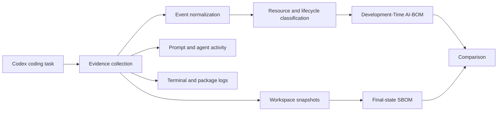

# Echo of the Agent

**Course:** CMSC818I, University of Maryland, College Park  
**Project type:** Graduate course project  

## Team

- Mingyoung Ban
- Kathan Paresh Vyas
- Chirag Advani

## Project idea

AI coding agents can install packages, download files, run scripts, call tools, and later remove some of those resources before a project is finished. A conventional Software Bill of Materials (SBOM) primarily reports what remains in the final codebase or build artifact. It can therefore miss temporary dependencies, failed installation attempts, exploratory downloads, and other resources that shaped the agent's development process.

**Echo of the Agent** investigates how to create a lightweight, evidence-based record of an AI coding agent's activity during a software task. We call this record a **Development-Time AI Bill of Materials (AI-BOM)**. Its purpose is to preserve an auditable "echo" of the external resources and tool actions involved while an agent creates or changes code.

## Research question

> What development-time resources used by an AI coding agent are absent from a final-state SBOM, and can simple activity evidence recover and classify them?

## Midterm goal

For the midterm, we will build a small prototype around one controlled coding task performed by **Codex** in an isolated local workspace.

The prototype will collect:

- The task prompt and available agent/tool activity.
- Terminal and package-manager output.
- Before-and-after snapshots of the project workspace.
- A final SBOM of the completed project.

We will use these artifacts to produce a small Development-Time AI-BOM that classifies observed resources into categories such as:

| Category | Meaning |
|---|---|
| Final dependency | Installed or used by the agent and retained in the completed project. |
| Temporary helper | Used during development but removed before the final state. |
| External resource | A downloaded file, dataset, script, or URL used during the task. |
| Failed attempt | A package or resource the agent attempted to use but could not successfully acquire or execute. |

### Midterm experiment

We will give Codex a bounded Python coding task in a clean repository. After the agent completes the task, we will compare:

1. A conventional final-state SBOM, generated from the completed project.
2. Our evidence-based Development-Time AI-BOM.

The experiment will help us learn whether the development-time record identifies resources that the final SBOM does not show. This is a feasibility study, not a claim that one task proves broad effectiveness.

## Initial system design



## Expected final-project outcome

By the final report, we aim to deliver a reusable prototype that can:

- Collect development-time evidence from a local AI coding-agent session.
- Map tool activity, package installation output, file changes, and external resources to a single coding task.
- Distinguish retained dependencies from temporary, failed, or removed resources.
- Export a structured Development-Time AI-BOM in JSON, with a path toward CycloneDX-compatible output.
- Compare the Development-Time AI-BOM with a conventional SBOM and explain the differences.
- Evaluate the approach on multiple controlled coding tasks and document its limitations, including incomplete logs, ambiguous resource usage, and false classifications.

The final project will focus on practical auditability and reproducibility. It will not attempt to prove that every observed resource is malicious or that an AI-BOM alone prevents software supply-chain attacks.

## Project status

**Current phase:** Midterm prototype and experiment design.  
**Initial agent environment:** Codex running locally with a dedicated experiment workspace.  
**Planned expansion:** More tasks, stronger evidence collection, improved lifecycle classification, and structured AI-BOM export.

## Repository structure

```text
Echo_of_the_agent/
├── README.md
├── scenario-repo/        # Controlled coding task workspace
├── evidence/             # Logs, snapshots, and SBOM outputs
├── scripts/              # Evidence collection and AI-BOM generation
├── output/               # Generated AI-BOM records
└── docs/                 # Report figures and supporting documentation
```

## Intended use

This repository is an academic research prototype for CMSC818I. It is designed to study visibility into AI-agent development activity, not to serve as a production security product.
