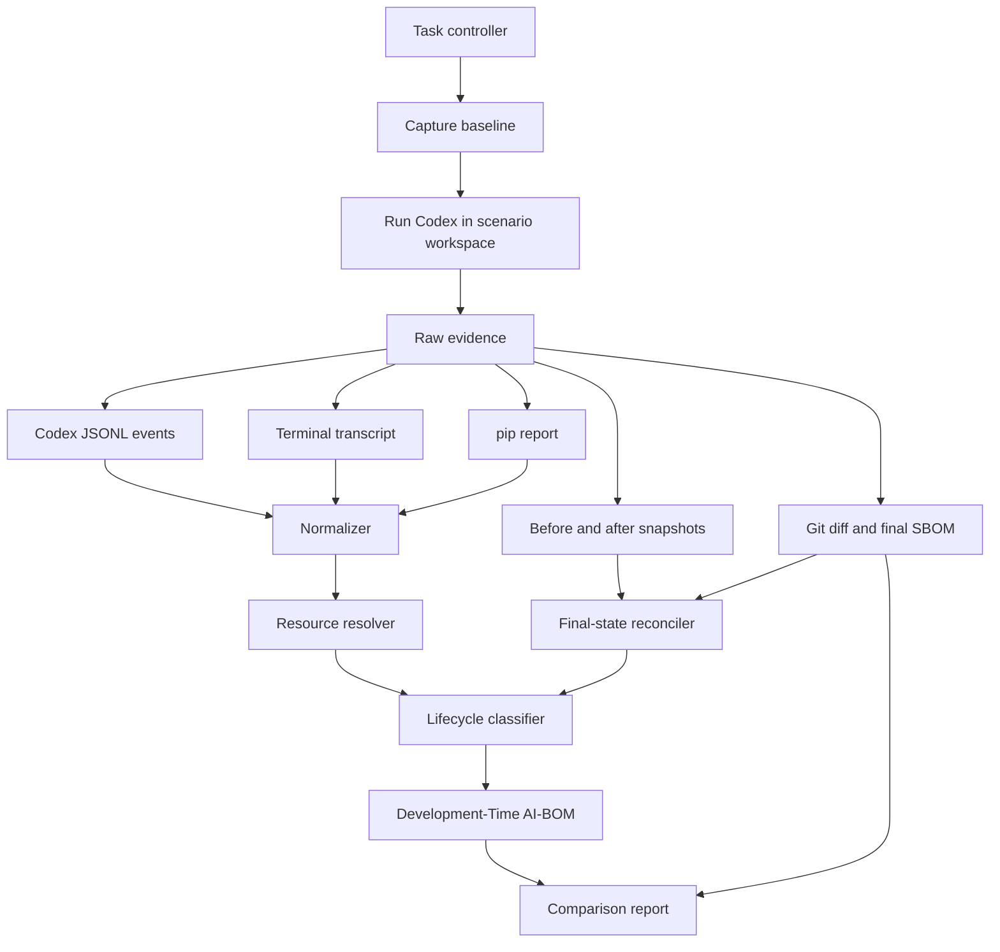

# Echo of the Agent — Midterm Implementation Specification

**Course:** CMSC818I, University of Maryland, College Park  
**Team:** Mingyoung Ban, Kathan Paresh Vyas, Chirag Advani  
**Repository:** `Echo_of_the_agent`  
**Status:** Approved implementation scope for the midterm prototype

---

## 1. Purpose

AI coding agents act on a development workspace: they inspect files, write code, run commands, install packages, download resources, and sometimes remove those resources before the task ends. A conventional Software Bill of Materials (SBOM) is a **final-state inventory**. It can identify dependencies remaining in a completed project, but it cannot reliably reconstruct temporary packages, failed installations, or downloaded resources that disappeared before the final scan.

**Echo of the Agent** is a lightweight, evidence-based prototype that records the development-time activity of one AI coding-agent run. The prototype produces a **Development-Time AI-BOM**: a structured record of resources observed during the run, the evidence supporting each record, and each resource's final lifecycle classification.

The midterm asks a narrow question:

> During one controlled Codex coding task, which observed resources are absent from the final-state SBOM, and can simple, reproducible evidence explain why?

This is a feasibility experiment. It does not claim to detect malicious software, provide complete operating-system forensics, or prove that all unseen resources were absent.

---

## 2. Midterm scope

### In scope

- One bounded Python coding task.
- One Codex CLI run on a local Windows machine.
- One clean Git workspace and one Python virtual environment.
- Capture of the task prompt, Codex JSONL events, terminal output, package-manager output, and before/after workspace snapshots.
- A final-state SBOM generated after the task.
- A Python analysis pipeline that produces JSON records and a readable comparison report.
- Resource lifecycle categories: `final_dependency`, `temporary_helper`, `external_resource`, and `failed_attempt`.


## 3. Proposed experiment

### 3.1 Controlled task

Create a new Python repository containing only a short `README.md` and a small input CSV file. Give Codex this task:

> Build a command-line Python program that reads `data/sales.csv`, reports total sales by category, and saves a bar chart as `output/sales_by_category.png`. Use `pandas` and `matplotlib` for the final solution. Record final dependencies in `requirements.txt`. You may use an exploratory terminal helper during development, but remove it if it is not required by the final program. Run the program before you finish.

The final solution is expected to retain `pandas` and `matplotlib`. A temporary helper may or may not be observed. If no temporary helper occurs naturally, run one additional **controlled validation run** with a prompt that explicitly asks Codex to use `rich` for terminal exploration and remove it before finalizing. The report must state that this second run is intentionally constructed to test temporary-resource detection.

### 3.2 Baseline and comparison

The experiment produces two inventories:

1. **Final-state SBOM:** packages and files discoverable in the completed project.
2. **Development-Time AI-BOM:** resources observed in commands, package reports, Codex event output, and snapshots.

The key comparison is the set difference:

```text
development_time_resources - final_state_components
```

Every item in that difference must point to evidence. A resource without evidence stays unresolved and must not be presented as a confirmed dependency.

---

## 4. Environment and prerequisites

### Required environment

| Item | Required configuration | Reason |
|---|---|---|
| Agent | Codex CLI authenticated through the team's existing ChatGPT plan | Runs the coding task locally |
| Runtime | Python 3.11+ | Scenario app and analysis scripts |
| Version control | Git | Baseline, diff, and reproducibility |
| Isolated dependencies | Python `.venv` inside `scenario-repo` | Keeps package activity scoped to the experiment |
| SBOM scanner | Syft preferred; cdxgen acceptable backup | Produces the final-state baseline |
| Shell | PowerShell | Captures terminal transcript and runs scripts |

No local model, paid API key, VirtualBox, or Docker is required. Codex reasoning uses the existing ChatGPT subscription while commands and files stay in the local experiment workspace.

### Codex execution policy

Use a dedicated Git workspace and run Codex with a workspace-write sandbox and approvals enabled. The recommended mode for this experiment is:

```powershell
codex exec --sandbox workspace-write --ask-for-approval on-request --json "<task prompt>"
```

`codex exec --json` emits newline-delimited JSON events and is suitable for repeatable local runs. The Codex CLI documentation recommends `workspace-write` for local work contained in the workspace and warns against bypassing sandboxing or approvals outside a dedicated isolated environment. See the [official Codex CLI reference](https://learn.chatgpt.com/docs/cli/reference).

Do **not** use `--yolo` or `--dangerously-bypass-approvals-and-sandbox` for the midterm.

---

## 5. Repository layout

Create the following folders before implementation. Files inside `evidence/runs/<run_id>/` are immutable after a run finishes; derived files go in `output/`.

```text
Echo_of_the_agent/
├── README.md
├── docs/
│   └── MIDTERM_IMPLEMENTATION_SPEC.md
├── scenario-repo/
│   ├── README.md
│   ├── data/sales.csv
│   └── .gitignore
├── evidence/
│   └── runs/
│       └── <run_id>/
│           ├── run-manifest.json
│           ├── prompt.md
│           ├── codex-events.jsonl
│           ├── terminal-transcript.txt
│           ├── pip-report.json
│           ├── before-snapshot.json
│           ├── after-snapshot.json
│           ├── git-diff.patch
│           └── final-sbom.cdx.json
├── scripts/
│   ├── init_run.py
│   ├── snapshot.py
│   ├── parse_events.py
│   ├── classify_resources.py
│   ├── export_ai_bom.py
│   └── compare_inventories.py
├── output/
│   └── <run_id>/
│       ├── normalized-events.jsonl
│       ├── resources.json
│       ├── development-time-ai-bom.json
│       ├── comparison.json
│       └── comparison.md
└── tests/
    ├── fixtures/
    └── test_classification.py
```

### Files that must not be scanned as final project content

Exclude the following from the final-project snapshot and SBOM scan:

- `.git/`
- `evidence/`
- `output/`
- Codex session artifacts outside `scenario-repo/`
- package-manager caches outside the scenario repository

The scenario repository's `.venv/` should be included in package evidence, but the report must state whether the chosen SBOM scanner includes or excludes it. The same scan scope must be used for every run.

---

## 6. Architecture



### Component responsibilities

| Component | Input | Output | Midterm responsibility |
|---|---|---|---|
| Task controller | Prompt, scenario path, tool versions | `run-manifest.json` and run ID | Creates the evidence directory and records configuration before execution |
| Baseline collector | Scenario workspace | `before-snapshot.json` | Records files, hashes, and declared dependencies before Codex starts |
| Raw collectors | Codex, PowerShell, pip, Git, scanner | Raw evidence files | Preserve original evidence without editing it |
| Normalizer | Raw logs | `normalized-events.jsonl` | Converts observations into one minimal event format |
| Resource resolver | Normalized events and pip report | Candidate resource identities | Matches package names, URLs, paths, and versions without guessing missing fields |
| Final-state reconciler | Final snapshot, requirements, SBOM | Presence assertions | Determines whether a resource remains in the completed project |
| Lifecycle classifier | Resource evidence plus presence | `resources.json` | Assigns one category and confidence to each resource |
| Exporter | Classified records | AI-BOM JSON and Markdown comparison | Produces reviewable output |

---

## 7. Data model

All generated JSON uses UTF-8, RFC 3339 UTC timestamps, and lowercase `snake_case` field names. IDs are UUID strings unless a different type is stated. Unknown values are `null`; do not use invented versions, hashes, or URLs.

### 7.1 Run manifest: `run-manifest.json`

```json
{
  "schema_version": "0.1",
  "run_id": "uuid",
  "started_at": "2026-10-16T18:30:00Z",
  "ended_at": null,
  "status": "prepared",
  "agent": {
    "name": "codex_cli",
    "version": "string_or_null",
    "sandbox_mode": "workspace-write",
    "approval_mode": "on-request"
  },
  "scenario": {
    "name": "sales_chart",
    "workspace_path": "scenario-repo",
    "git_commit_before": "sha_or_null"
  },
  "collector_versions": {
    "python": "string",
    "syft": "string_or_null"
  }
}
```

`status` is one of: `prepared`, `running`, `completed`, `failed`, or `interrupted`.

### 7.2 Canonical evidence event: `normalized-events.jsonl`

Each line is one JSON object. This schema is intentionally small so it can be produced from Codex output, terminal text, or package reports.

```json
{
  "event_id": "uuid",
  "run_id": "uuid",
  "timestamp": "2026-10-16T18:31:12Z",
  "source": "codex_jsonl",
  "event_type": "command_started",
  "outcome": "unknown",
  "tool_name": "shell",
  "command": "python -m pip install pandas matplotlib",
  "working_directory": "scenario-repo",
  "paths": ["scenario-repo/requirements.txt"],
  "urls": [],
  "package_hints": ["pandas", "matplotlib"],
  "raw_evidence": {
    "file": "evidence/runs/<run_id>/codex-events.jsonl",
    "line": 42,
    "sha256": "hex_digest_or_null"
  }
}
```

Allowed values:

| Field | Type | Allowed values / rule |
|---|---|---|
| `source` | string enum | `codex_jsonl`, `terminal_transcript`, `pip_report`, `snapshot`, `git_diff`, `sbom` |
| `event_type` | string enum | `command_started`, `command_finished`, `file_created`, `file_modified`, `file_deleted`, `package_requested`, `package_installed`, `package_removed`, `resource_downloaded`, `resource_executed`, `agent_message`, `parse_error` |
| `outcome` | string enum | `success`, `failure`, `unknown` |
| `command` | nullable string | Exact observed command after redaction; never reconstructed from guesswork |
| `paths`, `urls`, `package_hints` | array of strings | May be empty; preserve original casing in raw evidence and normalize separately for matching |
| `raw_evidence` | object | Must point to an existing raw file and line number or byte offset |

### 7.3 Resource record: `resources.json`

```json
{
  "resource_id": "res_01",
  "resource_type": "python_package",
  "name": "pandas",
  "version": "2.2.3",
  "purl": "pkg:pypi/pandas@2.2.3",
  "origin_url": null,
  "observed_actions": ["requested", "installed", "executed"],
  "final_presence": "present",
  "classification": "final_dependency",
  "confidence": "high",
  "evidence_event_ids": ["uuid_1", "uuid_2"],
  "notes": []
}
```

| Field | Type | Allowed values |
|---|---|---|
| `resource_type` | string enum | `python_package`, `url`, `file`, `script`, `command`, `unknown` |
| `observed_actions` | array enum | `requested`, `downloaded`, `installed`, `executed`, `removed`, `failed` |
| `final_presence` | string enum | `present`, `absent`, `unknown` |
| `classification` | string enum | `final_dependency`, `temporary_helper`, `external_resource`, `failed_attempt`, `unresolved` |
| `confidence` | string enum | `high`, `medium`, `low` |
| `evidence_event_ids` | non-empty array | Every classification requires at least one event ID |

### 7.4 Development-Time AI-BOM: `development-time-ai-bom.json`

```json
{
  "schema_version": "0.1",
  "bom_type": "development_time_ai_bom",
  "run_id": "uuid",
  "generated_at": "2026-10-16T19:00:00Z",
  "scope": {
    "agent": "codex_cli",
    "workspace": "scenario-repo",
    "final_sbom_path": "evidence/runs/<run_id>/final-sbom.cdx.json"
  },
  "resources": [],
  "evidence_files": [],
  "coverage": {
    "codex_event_log_available": true,
    "terminal_transcript_available": true,
    "pip_report_available": true,
    "before_snapshot_available": true,
    "after_snapshot_available": true,
    "known_gaps": []
  }
}
```

The AI-BOM is a project-specific evidence document. It is not represented as a fully conformant CycloneDX BOM until an official pinned CycloneDX schema validates the generated result.

---

## 8. Classification rules

The classifier must be deterministic: the same evidence input produces the same result.

| Classification | Required evidence | Final-state condition | Example |
|---|---|---|---|
| `final_dependency` | Successful install or use evidence | Present in `requirements.txt`, source import/use, or final SBOM | `pandas` |
| `temporary_helper` | Successful install, download, or execution evidence | Absent from final requirements, final source, and final SBOM scope | `rich` used then removed |
| `external_resource` | Observed URL download, local data file, script, or external command | May be present or absent | Test CSV downloaded from a URL |
| `failed_attempt` | Attempt evidence plus explicit failure outcome | No success evidence for the same resolved resource | Invalid package install |
| `unresolved` | Some evidence exists but identity or outcome is incomplete | Any | A package name mentioned only in agent text |

### Precedence rules

1. Preserve every observed action. A resource may have both `requested` and `failed` actions.
2. If there is successful install/use evidence and final presence is `present`, assign `final_dependency`.
3. If there is successful install/use evidence and final presence is `absent`, assign `temporary_helper`.
4. If the resource is a URL, downloaded file, script, or command that cannot be treated as a package, assign `external_resource` unless a stronger package classification applies.
5. If all known attempts failed and no success evidence exists, assign `failed_attempt`.
6. Otherwise assign `unresolved` and include the reason in `notes`.

### Confidence rules

- **High:** two independent supporting sources, such as `pip-report.json` plus final SBOM, or a command result plus a snapshot.
- **Medium:** one direct source with a successful outcome.
- **Low:** name extracted from unstructured text or incomplete output.

An `agent_message` mentioning a library is never enough to classify it as installed.

---

## 9. Implementation plan

### Step 1 — Prepare the scenario repository

1. Create `scenario-repo/` and initialize Git.
2. Add `data/sales.csv` and a short README containing the coding task context.
3. Create a fresh `.venv` under `scenario-repo/`.
4. Commit the baseline.
5. Run the initial snapshot script and save `before-snapshot.json`.

### Step 2 — Start an evidence run

`init_run.py` must:

1. Generate `run_id`.
2. Copy the exact prompt to `prompt.md`.
3. Record OS, Python, Git, Codex, and SBOM-scanner versions in `run-manifest.json`.
4. Create a separate immutable evidence directory.
5. Record the baseline Git commit.

### Step 3 — Run Codex and capture raw evidence

Run Codex only from `scenario-repo/`. Save the JSONL event stream to `codex-events.jsonl` and record the terminal session to `terminal-transcript.txt`.

`pip` commands performed by the agent should include `--report <path>` when possible. If Codex does not use that flag, capture package-manager console output and record the limitation under `coverage.known_gaps`.

### Step 4 — Capture final state

After Codex finishes:

1. Run the scenario program once and save its terminal result.
2. Save `after-snapshot.json`.
3. Save `git diff` against the baseline as `git-diff.patch`.
4. Generate the final-state SBOM from the same documented scan scope every time.
5. Mark the run `completed`, `failed`, or `interrupted` in `run-manifest.json`.

### Step 5 — Normalize and classify

1. `parse_events.py` reads raw evidence and emits one canonical event per JSONL line.
2. `classify_resources.py` groups evidence by normalized package name, URL, or path.
3. The classifier checks final presence using `requirements.txt`, source-code imports, after snapshot, and final SBOM.
4. `export_ai_bom.py` creates `resources.json` and `development-time-ai-bom.json`.
5. `compare_inventories.py` creates both `comparison.json` and a human-readable `comparison.md`.

---

## 10. Script contracts

| Script | CLI contract | Required output |
|---|---|---|
| `init_run.py` | `python scripts/init_run.py --scenario scenario-repo --prompt-file prompt.md` | Run directory and `run-manifest.json` |
| `snapshot.py` | `python scripts/snapshot.py --root scenario-repo --output <file>` | JSON list of relative paths, byte sizes, and SHA-256 hashes |
| `parse_events.py` | `python scripts/parse_events.py --run evidence/runs/<run_id>` | `normalized-events.jsonl` |
| `classify_resources.py` | `python scripts/classify_resources.py --run ... --output ...` | `resources.json` |
| `export_ai_bom.py` | `python scripts/export_ai_bom.py --run ... --resources ...` | `development-time-ai-bom.json` |
| `compare_inventories.py` | `python scripts/compare_inventories.py --ai-bom ... --sbom ...` | `comparison.json` and `comparison.md` |

The first version should use only Python's standard library except for testing. This reduces installation complexity and prevents the collector itself from adding confusing dependencies to the experiment.

---

## 11. Required outputs for the midterm

The final repository must contain one completed run with these artifacts:

| Artifact | Purpose | Acceptance check |
|---|---|---|
| `prompt.md` | Exact task instruction | Matches the report's described task |
| `run-manifest.json` | Run boundary and tool versions | Has run ID, timestamps, agent configuration, and status |
| Raw event and terminal logs | Replayable evidence | Files are present and referenced by canonical events |
| Before/after snapshots | Final-state reconciliation | Every changed file has a relative path and SHA-256 digest |
| `final-sbom.cdx.json` | Conventional final-state baseline | Valid JSON and scanner command recorded |
| `resources.json` | Classified resources | Every row has evidence IDs and no unsupported version values |
| `development-time-ai-bom.json` | Main project output | Contains resources and coverage gaps |
| `comparison.md` | Result for readers | Explains final-only, development-only, and unresolved resources |
| Tests | Rule reliability | At least one fixture per classification category |

### Minimum result table for the report

| Resource | Evidence observed | Final-state SBOM | AI-BOM classification | Interpretation |
|---|---|---|---|---|
| `pandas` | Package install and source import | Yes | Final dependency | Retained application dependency |
| `matplotlib` | Package install and source import | Yes | Final dependency | Retained application dependency |
| Temporary helper, if observed | Install/use followed by absence from final state | No | Temporary helper | Development-only resource |
| Failed resource, if observed | Explicit failed command | No | Failed attempt | Not a confirmed dependency |

Do not fabricate a temporary or failed row. If the original run does not produce one, report that result and execute the separately labeled controlled validation run.

---

## 12. Tests and validation

Implement fixture-driven tests before relying on the classifier. The following cases are required:

| Fixture | Expected classification |
|---|---|
| Successful `pip install pandas`, final `requirements.txt` contains pandas | `final_dependency` |
| Successful `pip install rich`, then `pip uninstall rich`; final state lacks rich | `temporary_helper` |
| `pip install package-that-does-not-exist` exits non-zero | `failed_attempt` |
| Successful download of `https://example.org/data.csv` | `external_resource` |
| Agent text says “consider requests” but no command or pip evidence exists | `unresolved` |

Validation checks:

1. Every `evidence_event_id` in `resources.json` exists in `normalized-events.jsonl`.
2. Every event's `raw_evidence.file` exists.
3. No resource classified as `final_dependency` has only an `agent_message` source.
4. No resource classified as `failed_attempt` has a successful install/use event for the same normalized identity.
5. Snapshot paths are relative, never absolute personal paths.
6. Secrets, authentication tokens, and private paths are redacted from saved command lines before sharing the repository.
7. The final SBOM scan scope is written in both `run-manifest.json` and `comparison.md`.

---

## 14. What success looks like at midterm

The midterm prototype succeeds if the team can demonstrate all of the following:

1. Codex completes or materially attempts the bounded coding task inside the dedicated workspace.
2. The team can preserve raw evidence for that one run.
3. The pipeline produces a readable Development-Time AI-BOM JSON file.
4. At least the retained dependencies are correctly classified with traceable evidence.
5. The comparison clearly states whether development-only resources were observed.
6. The report honestly describes missing evidence, failed parsing, and limits of one controlled run.

The experiment can still be valuable if Codex fails the coding task. In that case, preserve the partial evidence, set the run status to `failed`, and report what the pipeline could and could not infer.

---

## 15. Final-project extension path

After the midterm prototype works, the final project can expand in this order:

1. Repeat the same protocol across several controlled tasks.
2. Support JavaScript/npm evidence alongside Python/pip.
3. Improve identity resolution using package URLs, hashes, and lockfiles.
4. Add checkpoint AI-BOM revisions after meaningful code-edit milestones.
5. Compare static SBOM, package-manager evidence, and dynamic tracing tools such as cdxgen TraceBOM.
6. Export a schema-validated CycloneDX document plus an evidence sidecar.
7. Evaluate precision, recall, event loss, and overhead using fixture ground truth.

The final contribution should remain precise:

> Echo of the Agent studies whether an evidence-based activity record can reveal development-time resources that a final-state SBOM does not show.

It should not claim complete monitoring, security prevention, or universal agent coverage unless those properties are independently evaluated.

---

## 16. References informing the design

- [Codex CLI reference](https://learn.chatgpt.com/docs/cli/reference)
- [Syft](https://github.com/anchore/syft)
- [cdxgen TraceBOM guide](https://github.com/cdxgen/cdxgen/blob/master/docs/TRACEBOM.md)
- [AI Evidence BOM](https://github.com/Aaron911/ai-evidence-bom)
- [AgentProvenance](https://github.com/ByteYellow/AgentProvenance)
- [Pip installation reports](https://pip.pypa.io/en/stable/reference/installation-report/)
- [CycloneDX external-resource links](https://cyclonedx.org/use-cases/external-resource-links/)

These projects and papers informed the design. The midterm implementation is an original, deliberately simplified prototype; it does not reuse their claims as proof of our own results.
